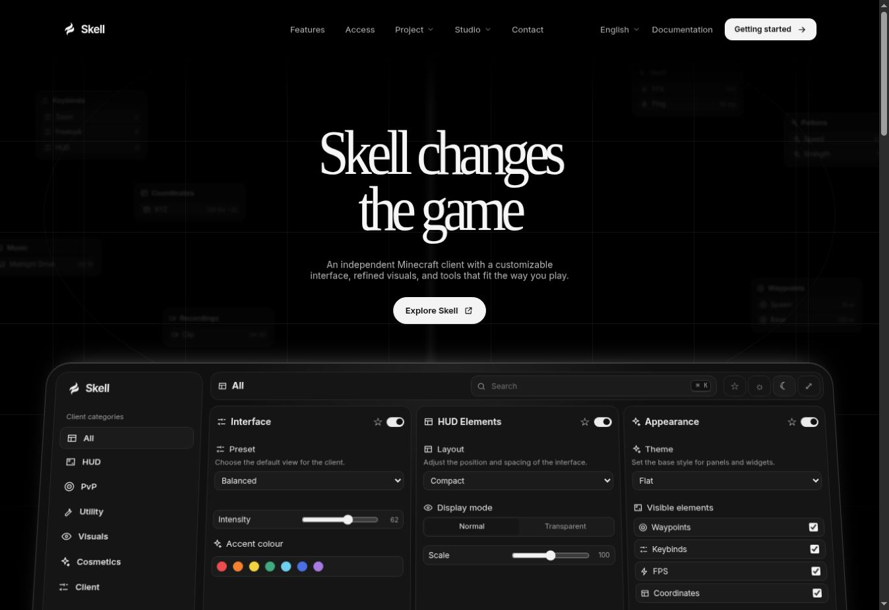
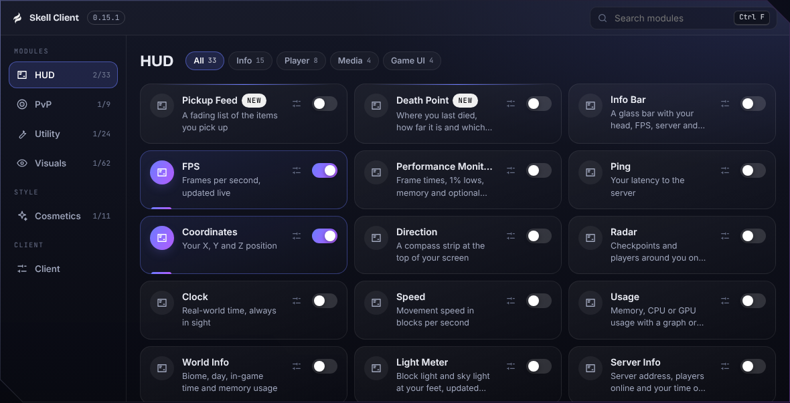
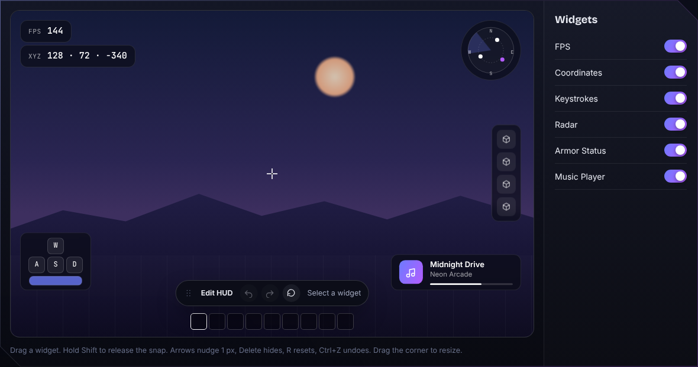
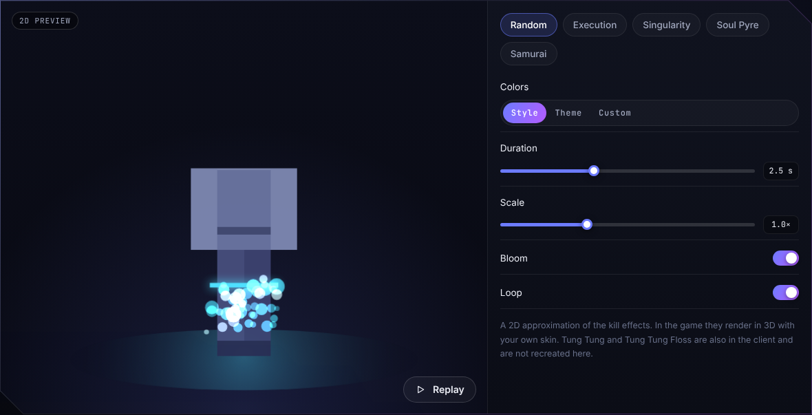
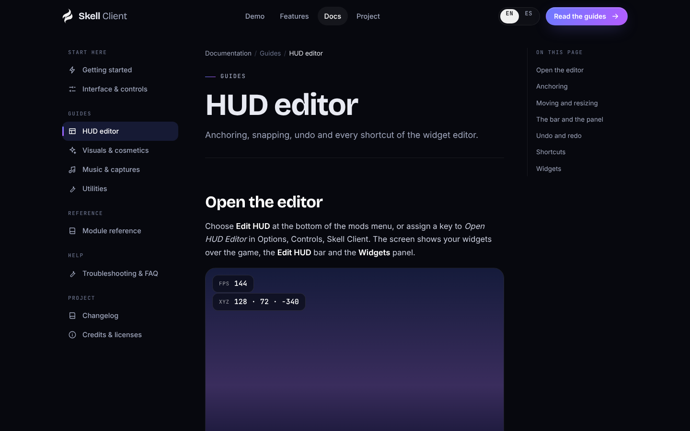
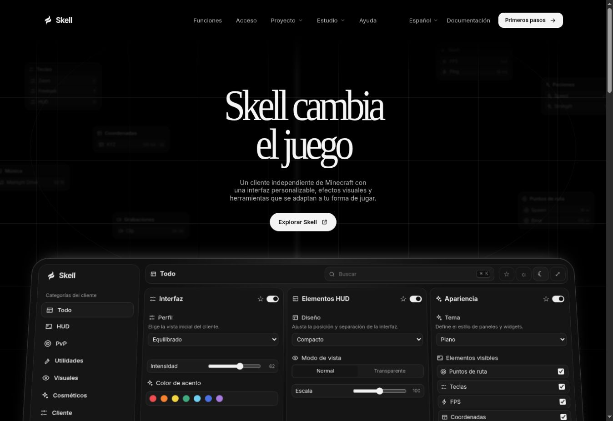
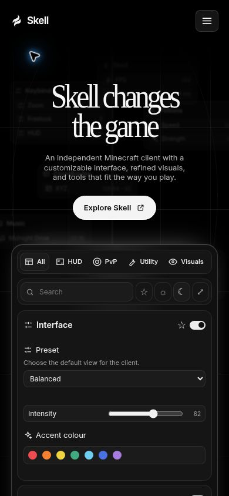
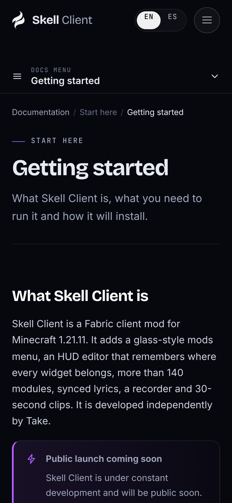

<p align="center">
  
</p>

<h1 align="center">Skell Web</h1>

<p align="center"><strong>The official website and documentation for Skell Client</strong></p>

<p align="center">
  <a href="#interactive-preview">Interactive preview</a> ·
  <a href="#documentation">Documentation</a> ·
  <a href="#run-the-site-locally">Local setup</a> ·
  <a href="#repository-structure">Source structure</a>
</p>



## Overview

I built Skell Web to give players a clear introduction to Skell Client, my independently developed Fabric client for Minecraft. The site brings the product overview, interactive interface previews, and user guides together so visitors can understand the client and try its main controls before installing it.

This repository contains the website for Skell Client **0.15.1**. I designed the landing page around a monochrome backdrop and an interactive settings panel, with direct access to the browser demos and guides. The landing page explains how the interface, visuals, cosmetics, music, captures, and utilities fit into the client. Each section links to the guide that covers the feature in more detail.

## Interactive preview

I built the settings preview at the top of the homepage with category filters, a search box, favourites, light and dark themes, and display controls. In the interactive studio below the features, I use the same module catalog to populate the full mods menu. The preview is intended to show how settings are organized and how common interactions feel. Game-dependent visuals, including the kill effects, are approximated in the browser.

| Preview | What I made available in the browser |
| --- | --- |
| **Mods menu** | Search the module catalog, browse categories, inspect module settings, and switch between the side panel and sheet layouts. |
| **HUD editor** | Drag and resize widgets, use snapping and alignment guides, nudge items with the keyboard, and undo or redo layout changes. |
| **Kill effects** | Preview the Execution, Singularity, Soul Pyre, and Samurai effects and adjust options such as color, duration, scale, and bloom. |
| **Recordings** | Explore the recorder, instant replay controls, and the library for recordings and clips. |



<p align="center">
  
  
</p>

## Documentation

I organized the documentation by task, from getting started and learning the controls to customizing the HUD and troubleshooting. A searchable module reference makes it possible to look up individual modules without paging through the feature guides.

| Topic | Coverage |
| --- | --- |
| **Getting started** | Compatibility and initial setup |
| **Interface and HUD** | Controls, settings layouts, widgets, and HUD editing |
| **Visuals and cosmetics** | Appearance options and visual effects |
| **Music and captures** | Music, synchronized lyrics, recording, and instant replay |
| **Reference and support** | Module catalog, utilities, FAQ, changelog, and credits |



I maintain English and Spanish editions of the landing page and documentation. English is served at `/` and Spanish at `/es/`. I also designed the navigation for narrow screens and included reduced-motion styles for visitors who prefer them.

<p align="center">
  
  
  
</p>

## Technical approach

I generate the website with Python’s standard library. The build reads configuration, localized content, and the module catalog, then produces static HTML, CSS, JavaScript, and assets under `site/`. I use native JavaScript modules for the browser interactions and load the demos as they approach the viewport. The build also generates the sitemap, language alternates, and a bilingual 404 page.

I keep the content and browser source separate so I can update copy, translations, and guides without editing generated HTML. The website build uses Python. The Java and Fabric versions below apply to the Minecraft client.

## Website sections

I built dedicated pages for pricing and checkout, account access, creator partnerships, the press kit, the knowledge base, and project information. Account access uses a temporary browser session. Checkout displays a sample order, and partnership submissions stay in the browser as drafts.

In Studio, I can browse the included texture samples or import the textures from my own Minecraft Java client JAR or resource-pack ZIP. I can edit pixels, save a draft, download individual images, and export a resource-pack ZIP for Minecraft 1.21.11. The press kit exports the Skell mark as SVG, PNG, or JPG.

## Run the site locally

Use Python **3.13**, the version used for development. I also verified the build and validation with Python **3.12**. The workflow uses the standard library and needs no package installation.

```bash
git clone https://github.com/TakeTerm/Skell-Web.git
cd Skell-Web
python3 -I scripts/build.py
python3 -I scripts/validate.py
python3 -m http.server 8000 --directory site
```

Open [the local homepage](http://localhost:8000/) or [the Spanish edition](http://localhost:8000/es/). Run commands from the repository root. On Windows, use `py -3` in place of `python3` if that is how Python is installed.

The build recreates `site/`, so make changes in `content/`, `src/`, or `scripts/` before rebuilding. I use the validator to check translation and documentation parity, duplicate HTML IDs, and internal links and anchors.

## Repository structure

| Path | What I keep there |
| --- | --- |
| [`content/en/`](content/en/) and [`content/es/`](content/es/) | Localized landing page copy, interface strings, and documentation |
| [`content/modules.json`](content/modules.json) | Module catalog shared by the demo and the documentation |
| [`src/scripts/`](src/scripts/) | Interactive demos, navigation, documentation controls, and lazy loading |
| [`src/styles/`](src/styles/) | Site, documentation, and demo styles |
| [`src/assets/`](src/assets/) | Brand assets, icons, and fonts |
| [`scripts/`](scripts/) | Site generator, content utilities, and validation |
| [`site.config.json`](site.config.json) | Product metadata, versions, languages, and canonical URL |
| [`site/`](site/) | Generated static site |
| [`readme/`](readme/) | Website screenshots used in this README |

## Deployment

I deploy the contents of `site/` as a static site. The included [Vercel configuration](vercel.json) sets trailing slashes, caching for assets, and security headers. Before deploying to another domain, update `siteUrl` in `site.config.json` and regenerate the site so the sitemap and canonical links point to the correct host.

The generated pages use root-relative paths for assets and navigation. Serve the output at the domain root, or adapt those paths before hosting it in a subdirectory.

## Client compatibility

| Component | Version |
| --- | --- |
| Skell Client | 0.15.1 |
| Minecraft | 1.21.11 |
| Fabric Loader | 0.20.1 |
| Fabric API | 0.141.6 |
| Java | 21 |

## Feedback and credits

I maintain Skell Web independently. If you find a problem, [open an issue](https://github.com/TakeTerm/Skell-Web/issues) with the affected page, your browser, and the steps to reproduce it. For a translation issue, include the language and the text that needs attention.

I use Bricolage Grotesque, Instrument Serif, Inter, and JetBrains Mono under the SIL Open Font License. Their license texts are included in [`src/assets/fonts/`](src/assets/fonts/).

© 2026 Take. All rights reserved. The Skell Client name, logo, website content, interface designs, and source code may be reproduced, distributed, or used only with my prior written permission. Third-party fonts retain their respective licenses.
